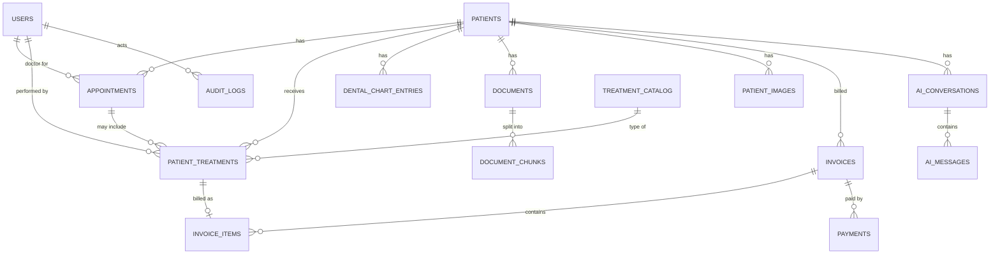

# Database

Database and ERD documentation.

# Database Design

**Engine:** PostgreSQL 16 with the `pgvector` extension (needed for the AI/RAG features)
**ORM / migrations:** SQLAlchemy 2.x + Alembic (`apps/api/migrations`)
**Owner:** backend. Any schema change is announced to the frontend owner first, then merged through a PR that includes the Alembic migration.

---

## 1. Conventions

| Topic | Rule |
|---|---|
| Primary keys | `id UUID` generated by the database (`gen_random_uuid()`) |
| Timestamps | Every table has `created_at` and `updated_at` (`TIMESTAMPTZ`, stored in UTC) |
| Naming | `snake_case`, plural table names, foreign keys named `<table_singular>_id` |
| Money | `NUMERIC(12,2)`, currency set once in `clinic_settings` (default `PKR`) |
| Deletes | Patients, users and treatment catalog items use **soft delete** (`deleted_at` / `is_active`). Medical records are never hard-deleted by the API. |
| Files | Files live on disk or object storage. The database stores only `file_path`, never file bytes. |
| Passwords | Only a bcrypt/argon2 hash is stored in `password_hash`. |
| Tooth numbering | **FDI two-digit notation** (11-18, 21-28, 31-38, 41-48 for adult teeth; 51-55, 61-65, 71-75, 81-85 for baby teeth). Enforced with a CHECK constraint. |
| Enums | Implemented as PostgreSQL enum types (listed in section 3). |

---

## 2. Entity relationship diagram



---

## 3. Enum types

| Enum | Values |
|---|---|
| `user_role` | `admin`, `doctor`, `receptionist` |
| `gender` | `male`, `female`, `other` |
| `appointment_status` | `scheduled`, `confirmed`, `in_progress`, `completed`, `cancelled`, `no_show` |
| `treatment_status` | `planned`, `in_progress`, `completed`, `cancelled` |
| `tooth_condition` | `healthy`, `cavity`, `filled`, `crown`, `root_canal`, `extracted`, `missing`, `implant`, `bridge`, `fractured`, `impacted`, `other` |
| `document_type` | `consent_form`, `prescription`, `lab_report`, `referral`, `insurance`, `other` |
| `image_type` | `xray_periapical`, `xray_bitewing`, `xray_panoramic`, `cbct`, `intraoral_photo`, `extraoral_photo`, `other` |
| `invoice_status` | `draft`, `issued`, `partially_paid`, `paid`, `void` |
| `payment_method` | `cash`, `card`, `bank_transfer`, `mobile_wallet`, `other` |
| `ai_message_role` | `user`, `assistant`, `system` |
| `index_status` | `pending`, `indexed`, `failed` |

---

## 4. Tables

### 4.1 `users` (clinic staff)

| Column | Type | Notes |
|---|---|---|
| id | UUID | PK |
| full_name | VARCHAR(120) | NOT NULL |
| email | VARCHAR(255) | NOT NULL, UNIQUE (stored lowercase) |
| password_hash | VARCHAR(255) | NOT NULL |
| role | user_role | NOT NULL |
| phone | VARCHAR(20) | |
| specialization | VARCHAR(100) | doctors only (e.g. Orthodontist) |
| is_active | BOOLEAN | NOT NULL, default `false`. New self-registered users stay inactive until an admin activates them. |
| last_login_at | TIMESTAMPTZ | |
| created_at, updated_at | TIMESTAMPTZ | |

### 4.2 `patients`

| Column | Type | Notes |
|---|---|---|
| id | UUID | PK |
| patient_number | VARCHAR(20) | UNIQUE, human-friendly (e.g. `P-000123`) generated from a sequence |
| first_name | VARCHAR(80) | NOT NULL |
| last_name | VARCHAR(80) | NOT NULL |
| gender | gender | |
| date_of_birth | DATE | |
| phone | VARCHAR(20) | NOT NULL |
| email | VARCHAR(255) | |
| address | TEXT | |
| national_id | VARCHAR(20) | CNIC, optional. Treat as sensitive. |
| emergency_contact_name | VARCHAR(120) | |
| emergency_contact_phone | VARCHAR(20) | |
| allergies | TEXT | free text |
| medical_history | TEXT | conditions, medications, etc. |
| notes | TEXT | |
| created_by | UUID | FK -> users.id |
| deleted_at | TIMESTAMPTZ | soft delete |
| created_at, updated_at | TIMESTAMPTZ | |

Indexes: `(last_name, first_name)`, `phone`, `patient_number`, plus a trigram index (`pg_trgm`) on `first_name || ' ' || last_name` for fast search.

### 4.3 `appointments`

| Column | Type | Notes |
|---|---|---|
| id | UUID | PK |
| patient_id | UUID | FK -> patients.id, NOT NULL |
| doctor_id | UUID | FK -> users.id, NOT NULL (must have role `doctor`) |
| start_time | TIMESTAMPTZ | NOT NULL |
| end_time | TIMESTAMPTZ | NOT NULL, CHECK `end_time > start_time` |
| status | appointment_status | NOT NULL, default `scheduled` |
| reason | VARCHAR(255) | |
| notes | TEXT | |
| cancelled_reason | VARCHAR(255) | |
| created_by | UUID | FK -> users.id |
| created_at, updated_at | TIMESTAMPTZ | |

Indexes: `(doctor_id, start_time)`, `(patient_id, start_time)`, `(start_time)`.
**Double-booking rule:** a doctor cannot have two non-cancelled appointments that overlap. Enforce it in the database with an exclusion constraint (`btree_gist` extension):
`EXCLUDE USING gist (doctor_id WITH =, tstzrange(start_time, end_time) WITH &&) WHERE (status NOT IN ('cancelled','no_show'))`.
The API converts the violation into a `409 APPOINTMENT_CONFLICT`.

### 4.4 `treatment_catalog` (the clinic's price list)

| Column | Type | Notes |
|---|---|---|
| id | UUID | PK |
| code | VARCHAR(20) | UNIQUE, e.g. `RCT-01` |
| name | VARCHAR(150) | NOT NULL (e.g. Root Canal, Scaling, Extraction) |
| category | VARCHAR(80) | e.g. Endodontics, Orthodontics, Preventive |
| description | TEXT | |
| default_price | NUMERIC(12,2) | NOT NULL |
| default_duration_min | INTEGER | used to pre-fill appointment length |
| is_active | BOOLEAN | NOT NULL, default `true` |
| created_at, updated_at | TIMESTAMPTZ | |

### 4.5 `patient_treatments`

A treatment planned for or performed on a specific patient.

| Column | Type | Notes |
|---|---|---|
| id | UUID | PK |
| patient_id | UUID | FK -> patients.id, NOT NULL |
| catalog_id | UUID | FK -> treatment_catalog.id, NOT NULL |
| appointment_id | UUID | FK -> appointments.id, nullable |
| doctor_id | UUID | FK -> users.id, NOT NULL |
| tooth_number | SMALLINT | FDI, nullable (some treatments are not tooth-specific) |
| surfaces | VARCHAR(10) | e.g. `MOD` (mesial, occlusal, distal) |
| status | treatment_status | NOT NULL, default `planned` |
| price | NUMERIC(12,2) | NOT NULL, copied from catalog but editable per patient |
| discount | NUMERIC(12,2) | NOT NULL, default 0 |
| notes | TEXT | clinical notes |
| performed_at | TIMESTAMPTZ | set when status becomes `completed` |
| created_at, updated_at | TIMESTAMPTZ | |

Indexes: `(patient_id, status)`, `(patient_id, tooth_number)`.

### 4.6 `dental_chart_entries`

The chart is stored as **history**: each change is a new row, so you can see how a tooth changed over time. The current chart is the latest row per tooth.

| Column | Type | Notes |
|---|---|---|
| id | UUID | PK |
| patient_id | UUID | FK -> patients.id, NOT NULL |
| tooth_number | SMALLINT | NOT NULL, FDI, validated by CHECK |
| surface | VARCHAR(5) | optional: `M`, `O`, `D`, `B`, `L`, `I` |
| condition | tooth_condition | NOT NULL |
| notes | TEXT | |
| recorded_by | UUID | FK -> users.id, NOT NULL |
| recorded_at | TIMESTAMPTZ | NOT NULL, default now |
| created_at | TIMESTAMPTZ | |

Index: `(patient_id, tooth_number, recorded_at DESC)`.

Current chart query (latest row per tooth):
```sql
SELECT DISTINCT ON (tooth_number) *
FROM dental_chart_entries
WHERE patient_id = :patient_id
ORDER BY tooth_number, recorded_at DESC;
```

### 4.7 `documents`

| Column | Type | Notes |
|---|---|---|
| id | UUID | PK |
| patient_id | UUID | FK -> patients.id, NOT NULL |
| type | document_type | NOT NULL |
| title | VARCHAR(200) | NOT NULL |
| file_path | VARCHAR(500) | NOT NULL |
| mime_type | VARCHAR(100) | NOT NULL |
| size_bytes | BIGINT | NOT NULL |
| index_status | index_status | NOT NULL, default `pending` (AI indexing state) |
| uploaded_by | UUID | FK -> users.id |
| created_at, updated_at | TIMESTAMPTZ | |

### 4.8 `patient_images` (X-rays and photos)

| Column | Type | Notes |
|---|---|---|
| id | UUID | PK |
| patient_id | UUID | FK -> patients.id, NOT NULL |
| image_type | image_type | NOT NULL |
| tooth_number | SMALLINT | optional |
| file_path | VARCHAR(500) | NOT NULL |
| thumbnail_path | VARCHAR(500) | |
| mime_type | VARCHAR(100) | NOT NULL |
| size_bytes | BIGINT | NOT NULL |
| taken_at | DATE | when the image was taken |
| notes | TEXT | |
| uploaded_by | UUID | FK -> users.id |
| created_at, updated_at | TIMESTAMPTZ | |

### 4.9 `invoices`

| Column | Type | Notes |
|---|---|---|
| id | UUID | PK |
| invoice_number | VARCHAR(20) | UNIQUE, e.g. `INV-2026-0001` |
| patient_id | UUID | FK -> patients.id, NOT NULL |
| status | invoice_status | NOT NULL, default `draft` |
| subtotal | NUMERIC(12,2) | NOT NULL |
| discount | NUMERIC(12,2) | NOT NULL, default 0 |
| total | NUMERIC(12,2) | NOT NULL, CHECK `total >= 0` |
| paid_amount | NUMERIC(12,2) | NOT NULL, default 0, maintained from payments |
| issued_at | TIMESTAMPTZ | |
| due_date | DATE | |
| notes | TEXT | |
| created_by | UUID | FK -> users.id |
| created_at, updated_at | TIMESTAMPTZ | |

### 4.10 `invoice_items`

| Column | Type | Notes |
|---|---|---|
| id | UUID | PK |
| invoice_id | UUID | FK -> invoices.id, NOT NULL, ON DELETE CASCADE |
| patient_treatment_id | UUID | FK -> patient_treatments.id, nullable (custom line items allowed) |
| description | VARCHAR(255) | NOT NULL |
| quantity | INTEGER | NOT NULL, default 1 |
| unit_price | NUMERIC(12,2) | NOT NULL |
| line_total | NUMERIC(12,2) | NOT NULL |

### 4.11 `payments`

| Column | Type | Notes |
|---|---|---|
| id | UUID | PK |
| invoice_id | UUID | FK -> invoices.id, NOT NULL |
| amount | NUMERIC(12,2) | NOT NULL, CHECK `amount > 0` |
| method | payment_method | NOT NULL |
| reference | VARCHAR(100) | transaction or receipt number |
| paid_at | TIMESTAMPTZ | NOT NULL, default now |
| received_by | UUID | FK -> users.id |
| created_at | TIMESTAMPTZ | |

Payments are never edited or deleted. A mistake is corrected by voiding the invoice or adding a new entry. When a payment is added, the API updates `invoices.paid_amount` and `invoices.status` (`partially_paid` or `paid`) in the same transaction.

### 4.12 `clinic_settings` (single row)

| Column | Type | Notes |
|---|---|---|
| id | SMALLINT | PK, always `1` (CHECK `id = 1`) |
| clinic_name | VARCHAR(150) | NOT NULL |
| address | TEXT | |
| phone | VARCHAR(20) | |
| email | VARCHAR(255) | |
| currency | CHAR(3) | default `PKR` |
| timezone | VARCHAR(50) | default `Asia/Karachi` |
| working_hours | JSONB | e.g. `{"mon": ["09:00","17:00"], "sun": null}` |
| default_slot_min | INTEGER | default 30 |
| updated_at | TIMESTAMPTZ | |

---

## 5. AI / RAG tables

### 5.1 `document_chunks`

Text from uploaded documents, split into small pieces and embedded, so the AI can retrieve relevant parts.

| Column | Type | Notes |
|---|---|---|
| id | UUID | PK |
| document_id | UUID | FK -> documents.id, NOT NULL, ON DELETE CASCADE |
| patient_id | UUID | FK -> patients.id, NOT NULL (copied here so every search is filtered by patient) |
| chunk_index | INTEGER | NOT NULL |
| content | TEXT | NOT NULL |
| embedding | VECTOR(1536) | `pgvector`. The dimension must match the embedding model you choose; change it in a migration if you switch models. |
| created_at | TIMESTAMPTZ | |

Indexes: HNSW on `embedding` (`vector_cosine_ops`), and `(patient_id)`.
**Privacy rule:** every retrieval query must include `WHERE patient_id = :patient_id`. The AI for one patient must never see another patient's data.

### 5.2 `ai_conversations`

| Column | Type | Notes |
|---|---|---|
| id | UUID | PK |
| patient_id | UUID | FK -> patients.id, NOT NULL |
| user_id | UUID | FK -> users.id, NOT NULL (the staff member chatting) |
| title | VARCHAR(200) | |
| created_at, updated_at | TIMESTAMPTZ | |

### 5.3 `ai_messages`

| Column | Type | Notes |
|---|---|---|
| id | UUID | PK |
| conversation_id | UUID | FK -> ai_conversations.id, NOT NULL, ON DELETE CASCADE |
| role | ai_message_role | NOT NULL |
| content | TEXT | NOT NULL |
| sources | JSONB | which chunks, documents or chart entries were used, so answers can show citations |
| model | VARCHAR(80) | which model produced the answer |
| created_at | TIMESTAMPTZ | |

Index: `(conversation_id, created_at)`.

---

## 6. `audit_logs`

Patient records are sensitive, so important actions are recorded.

| Column | Type | Notes |
|---|---|---|
| id | UUID | PK |
| user_id | UUID | FK -> users.id |
| action | VARCHAR(50) | e.g. `patient.view`, `patient.update`, `document.download`, `invoice.void` |
| entity_type | VARCHAR(50) | |
| entity_id | UUID | |
| ip_address | INET | |
| details | JSONB | what changed (never store passwords or tokens) |
| created_at | TIMESTAMPTZ | |

Index: `(entity_type, entity_id)`, `(user_id, created_at)`.

---

## 7. Business rules the database must keep true

1. A doctor cannot have overlapping active appointments (exclusion constraint, section 4.3).
2. `appointments.doctor_id` must reference a user with role `doctor` (checked in the service layer).
3. Tooth numbers must be valid FDI numbers.
4. `invoices.paid_amount` never exceeds `invoices.total`.
5. Payments cannot be added to `void` or `draft` invoices.
6. Soft-deleted patients disappear from lists and search but their records remain for audit.
7. Every file path points to a file that exists. Deleting a record deletes its file in the same operation.

---

## 8. Required PostgreSQL extensions

```sql
CREATE EXTENSION IF NOT EXISTS "pgcrypto";   -- gen_random_uuid()
CREATE EXTENSION IF NOT EXISTS "pg_trgm";    -- fast patient name search
CREATE EXTENSION IF NOT EXISTS "btree_gist"; -- appointment overlap constraint
CREATE EXTENSION IF NOT EXISTS "vector";     -- pgvector for RAG
```

In `docker-compose.yml`, use the image `pgvector/pgvector:pg16` instead of plain `postgres`, otherwise the `vector` extension will not exist.

---

## 9. Migration workflow (how we both stay in sync)

1. Change the SQLAlchemy models in `apps/api/app/models`.
2. Generate a migration: `alembic revision --autogenerate -m "add patients table"`
3. **Read the generated file** and fix anything wrong. Autogenerate is not perfect (it misses extensions and enum changes).
4. Apply it: `alembic upgrade head`
5. Commit the model change and the migration file together in one PR.
6. The other person pulls and runs `alembic upgrade head`.

Never edit the database by hand and never edit a migration that has already been merged. Add a new one instead.

---

## 10. Build order

| Phase | Tables |
|---|---|
| 1 | `users`, `clinic_settings` |
| 2 | `patients`, `appointments`, `treatment_catalog`, `patient_treatments` |
| 3 | `dental_chart_entries`, `documents`, `patient_images`, `invoices`, `invoice_items`, `payments` |
| 4 | `document_chunks`, `ai_conversations`, `ai_messages` |
| Throughout | `audit_logs` (add early, start writing to it from Phase 2) |

---

## 11. Seed data (`database/seeds`)

- 1 admin, 2 doctors, 1 receptionist (development passwords only, never reused in production)
- ~25 common treatments with prices (scaling, filling, root canal, extraction, crown, braces consultation, whitening, X-ray)
- ~15 fake patients with fake names and phone numbers (never real patient data)
- A few appointments, treatments and invoices so the frontend has realistic data to show
