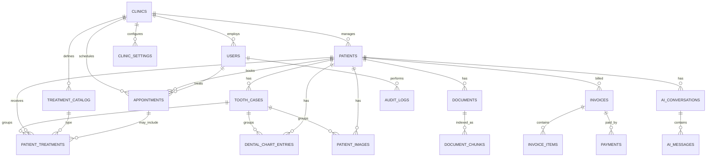

# Database Design

Dent-Dungeon is a dental practice workspace for solo dentists and clinics with staff.

**Database:** Supabase-hosted PostgreSQL (PostgreSQL 16-compatible), with `pgvector` for planned RAG.  
**ORM/migrations:** SQLAlchemy 2.x + Alembic (`apps/api/migrations`).  
**Schema owner:** Backend. Coordinate changes with the frontend owner and commit models plus migrations together.

## 1. Conventions

| Topic | Rule |
|---|---|
| Primary keys | UUID generated by PostgreSQL with `gen_random_uuid()` |
| Timestamps | `TIMESTAMPTZ` in UTC; use `created_at`/`updated_at` where applicable |
| Naming | `snake_case`, plural table names |
| Money | `NUMERIC(12,2)`; currency is configured per clinic, default `PKR` |
| Tenant isolation | Each business record belongs to a `clinic_id`; scope every API query to the authenticated user's clinic |
| Deletes | Soft-delete/deactivate patients and staff; retain clinical and financial history |
| Files | Private object storage; database stores metadata/path, never file bytes |
| Passwords | Store password hashes only (Argon2 recommended) |
| Teeth | FDI: adult 11–18, 21–28, 31–38, 41–48; primary 51–55, 61–65, 71–75, 81–85 |
| Clinical history | Chart changes are historical entries; audit important actions |
| Secrets | Never commit `.env` or store credentials in docs/logs |

## 2. Tenant model

A clinic is the tenant boundary. A solo dentist creates a clinic and is its first admin; the same account can also be a practitioner. Established clinics can add doctors and receptionists later.

- `clinics` owns staff, patients, appointments, treatment catalog, tooth cases, dental chart, documents/images, invoices/payments, settings, audit logs and AI conversations.
- Add `clinic_id` to each top-level clinic-owned table. Child tables inherit scope through their parent, but the service layer must verify the parent and all linked records belong to the same clinic.
- Never trust a client-supplied `clinic_id` to authorize access. Derive it from the authenticated user.
- Scope all queries, updates, deletes, file downloads, dashboard aggregates and AI retrieval by clinic.
- Consider PostgreSQL Row Level Security as an additional defense after the API authentication/connection model is established.
- Staff email is globally unique for initial login. Patient email is not collected.

## 3. ER diagram

## 4. Enum types

| Enum | Values |
|---|---|
| `user_role` | `admin`, `doctor`, `receptionist` |
| `gender` | `male`, `female`, `other` |
| `appointment_status` | `scheduled`, `confirmed`, `in_progress`, `completed`, `cancelled`, `no_show` |
| `treatment_status` | `planned`, `in_progress`, `completed`, `cancelled` |
| `tooth_case_status` | `open`, `in_progress`, `resolved`, `closed` |
| `tooth_condition` | `healthy`, `cavity`, `filled`, `crown`, `root_canal`, `extracted`, `missing`, `implant`, `bridge`, `fractured`, `impacted`, `other` |
| `document_type` | `consent_form`, `prescription`, `lab_report`, `referral`, `insurance`, `other` |
| `image_type` | `xray_periapical`, `xray_bitewing`, `xray_panoramic`, `cbct`, `intraoral_photo`, `extraoral_photo`, `other` |
| `invoice_status` | `draft`, `issued`, `partially_paid`, `paid`, `void` |
| `payment_method` | `cash`, `card`, `bank_transfer`, `mobile_wallet`, `other` |
| `ai_message_role` | `user`, `assistant`, `system` |
| `index_status` | `pending`, `indexed`, `failed` |

## 5. Tables

### 5.1 `clinics`

One row per practice/tenant.

| Column | Type | Notes |
|---|---|---|
| `id` | UUID | PK |
| `name` | VARCHAR(150) | NOT NULL |
| `slug` | VARCHAR(180) | Nullable unique URL-friendly name |
| `is_active` | BOOLEAN | NOT NULL, default `true` |
| `created_at`, `updated_at` | TIMESTAMPTZ | UTC |

Create the clinic and its first admin in one transaction.

### 5.2 `users` (staff)

| Column | Type | Notes |
|---|---|---|
| `id` | UUID | PK |
| `clinic_id` | UUID | FK -> `clinics.id`, NOT NULL |
| `full_name` | VARCHAR(120) | NOT NULL |
| `email` | VARCHAR(255) | NOT NULL, globally UNIQUE, normalized lowercase |
| `password_hash` | VARCHAR(255) | NOT NULL |
| `role` | `user_role` | NOT NULL |
| `phone` | VARCHAR(20) | Nullable staff phone |
| `specialization` | VARCHAR(100) | Nullable, e.g. Orthodontist |
| `is_practitioner` | BOOLEAN | NOT NULL, default `false`; admin can also treat patients |
| `is_active` | BOOLEAN | NOT NULL; creator active, invited staff active after acceptance |
| `last_login_at` | TIMESTAMPTZ | Nullable |
| `deleted_at` | TIMESTAMPTZ | Nullable soft-delete timestamp |
| `created_at`, `updated_at` | TIMESTAMPTZ | UTC |

A user can be `admin` and `is_practitioner=true`. Appointment attribution accepts active users with `role=doctor` or `is_practitioner=true`. Admins who are not practitioners cannot be assigned as treating clinicians.

### 5.3 `patients`

| Column | Type | Notes |
|---|---|---|
| `id` | UUID | PK |
| `clinic_id` | UUID | FK -> `clinics.id`, NOT NULL |
| `patient_number` | VARCHAR(20) | Unique within clinic, e.g. `P-000123`, backend-generated |
| `first_name` | VARCHAR(80) | NOT NULL |
| `last_name` | VARCHAR(80) | NOT NULL |
| `gender` | `gender` | Nullable |
| `date_of_birth` | DATE | Nullable |
| `phone` | VARCHAR(20) | Nullable; optional |
| `emergency_contact_name` | VARCHAR(120) | Nullable |
| `emergency_contact_phone` | VARCHAR(20) | Nullable |
| `allergies` | TEXT | Nullable free text |
| `medical_history` | TEXT | Nullable general medical conditions/history |
| `medications` | TEXT | Nullable current medications/dosage as reported |
| `notes` | TEXT | Nullable general patient notes |
| `created_by` | UUID | FK -> `users.id`, nullable for imports/system |
| `deleted_at` | TIMESTAMPTZ | Nullable soft-delete timestamp |
| `created_at`, `updated_at` | TIMESTAMPTZ | UTC |

**Intentionally excluded:** patient CNIC/national ID, residential address and email. Patient phone is optional. Clinic address/email remain in clinic settings; staff email remains for login.

Indexes: `(clinic_id, last_name, first_name)`, unique `(clinic_id, patient_number)`, `(clinic_id, phone)` when phone is present, and a `pg_trgm` index for fuzzy name search. Do not make phone unique; family members may share it.

Patient-number generation must be concurrency-safe and clinic-scoped (e.g. per-clinic counter or sequence managed transactionally).

### 5.4 `clinic_settings`

One row per clinic, not a global singleton.

| Column | Type | Notes |
|---|---|---|
| `id` | UUID | PK |
| `clinic_id` | UUID | FK -> `clinics.id`, NOT NULL, UNIQUE |
| `clinic_name` | VARCHAR(150) | NOT NULL |
| `address` | TEXT | Optional clinic address, not patient address |
| `phone` | VARCHAR(20) | Optional clinic phone |
| `email` | VARCHAR(255) | Optional clinic contact email |
| `currency` | CHAR(3) | NOT NULL, default `PKR` |
| `timezone` | VARCHAR(50) | NOT NULL, default `Asia/Karachi` |
| `working_hours` | JSONB | E.g. `{"mon":["09:00","17:00"],"sun":null}` |
| `default_slot_min` | INTEGER | NOT NULL, default 30 |
| `created_at`, `updated_at` | TIMESTAMPTZ | UTC |

### 5.5 `appointments`

| Column | Type | Notes |
|---|---|---|
| `id` | UUID | PK |
| `clinic_id` | UUID | FK -> `clinics.id`, NOT NULL |
| `patient_id` | UUID | FK -> `patients.id`, NOT NULL |
| `doctor_id` | UUID | FK -> `users.id`, NOT NULL; active practitioner in same clinic |
| `start_time` | TIMESTAMPTZ | NOT NULL |
| `end_time` | TIMESTAMPTZ | NOT NULL, CHECK `end_time > start_time` |
| `status` | `appointment_status` | NOT NULL, default `scheduled` |
| `reason` | VARCHAR(255) | Nullable |
| `notes` | TEXT | Nullable |
| `cancelled_reason` | VARCHAR(255) | Nullable |
| `created_by` | UUID | FK -> `users.id` |
| `created_at`, `updated_at` | TIMESTAMPTZ | UTC |

Indexes: `(clinic_id, doctor_id, start_time)`, `(clinic_id, patient_id, start_time)`, `(clinic_id, start_time)`. Prevent overlapping appointments for the same practitioner with a PostgreSQL exclusion constraint using `btree_gist`; exclude `cancelled` and `no_show`. Patient, doctor and appointment clinic IDs must match.

### 5.6 `treatment_catalog`

Clinic-specific price list.

| Column | Type | Notes |
|---|---|---|
| `id` | UUID | PK |
| `clinic_id` | UUID | FK -> `clinics.id`, NOT NULL |
| `code` | VARCHAR(20) | Unique within clinic |
| `name` | VARCHAR(150) | NOT NULL |
| `category` | VARCHAR(80) | Nullable |
| `description` | TEXT | Nullable |
| `default_price` | NUMERIC(12,2) | NOT NULL, CHECK >= 0 |
| `default_duration_min` | INTEGER | Nullable |
| `is_active` | BOOLEAN | NOT NULL, default `true` |
| `created_at`, `updated_at` | TIMESTAMPTZ | UTC |

Unique constraint: `(clinic_id, code)`.

### 5.7 `tooth_cases`

Groups tooth-specific clinical notes, findings, treatment plans, treatments and imaging. The same tooth may have multiple cases over time.

| Column | Type | Notes |
|---|---|---|
| `id` | UUID | PK |
| `clinic_id` | UUID | FK -> `clinics.id`, NOT NULL |
| `patient_id` | UUID | FK -> `patients.id`, NOT NULL |
| `tooth_number` | SMALLINT | NOT NULL; valid FDI number |
| `title` | VARCHAR(180) | NOT NULL, e.g. “Tooth 11 fracture assessment” |
| `status` | `tooth_case_status` | NOT NULL, default `open` |
| `diagnosis_notes` | TEXT | Nullable clinician-entered findings |
| `treatment_plan` | TEXT | Nullable |
| `created_by` | UUID | FK -> `users.id`, NOT NULL |
| `created_at`, `updated_at` | TIMESTAMPTZ | UTC |
| `closed_at` | TIMESTAMPTZ | Nullable |

Indexes: `(clinic_id, patient_id, tooth_number)` and `(clinic_id, patient_id, status)`. Do not make `(patient_id, tooth_number)` unique. Ensure case patient belongs to the same clinic.

### 5.8 `patient_treatments`

| Column | Type | Notes |
|---|---|---|
| `id` | UUID | PK |
| `clinic_id` | UUID | FK -> `clinics.id`, NOT NULL |
| `patient_id` | UUID | FK -> `patients.id`, NOT NULL |
| `catalog_id` | UUID | FK -> `treatment_catalog.id`, NOT NULL |
| `tooth_case_id` | UUID | FK -> `tooth_cases.id`, nullable |
| `appointment_id` | UUID | FK -> `appointments.id`, nullable |
| `doctor_id` | UUID | FK -> `users.id`, NOT NULL |
| `tooth_number` | SMALLINT | Nullable FDI number; general treatments may not target one tooth |
| `surfaces` | VARCHAR(10) | Nullable, e.g. `MOD` |
| `status` | `treatment_status` | NOT NULL, default `planned` |
| `price` | NUMERIC(12,2) | NOT NULL; snapshot of catalog price |
| `discount` | NUMERIC(12,2) | NOT NULL, default 0, CHECK >= 0 |
| `notes` | TEXT | Nullable clinical notes |
| `performed_at` | TIMESTAMPTZ | Set when completed |
| `created_at`, `updated_at` | TIMESTAMPTZ | UTC |

Indexes: `(clinic_id, patient_id, status)`, `(clinic_id, patient_id, tooth_number)`, `(tooth_case_id)`. If case is present, its clinic, patient and tooth must match this treatment.

### 5.9 `dental_chart_entries`

Append-only historical findings; each change creates a new row.

| Column | Type | Notes |
|---|---|---|
| `id` | UUID | PK |
| `clinic_id` | UUID | FK -> `clinics.id`, NOT NULL |
| `patient_id` | UUID | FK -> `patients.id`, NOT NULL |
| `tooth_case_id` | UUID | FK -> `tooth_cases.id`, nullable |
| `tooth_number` | SMALLINT | NOT NULL, FDI CHECK |
| `surface` | VARCHAR(5) | Nullable: `M`, `O`, `D`, `B`, `L`, `I` |
| `condition` | `tooth_condition` | NOT NULL |
| `notes` | TEXT | Nullable |
| `recorded_by` | UUID | FK -> `users.id`, NOT NULL |
| `recorded_at` | TIMESTAMPTZ | NOT NULL, default now |
| `created_at` | TIMESTAMPTZ | UTC |

Index: `(clinic_id, patient_id, tooth_number, recorded_at DESC)`. If linked to a case, patient, clinic and tooth must match. Current chart is latest entry per tooth; if surface-level charting is enabled, query latest per tooth and surface.

### 5.10 `documents`

| Column | Type | Notes |
|---|---|---|
| `id` | UUID | PK |
| `clinic_id` | UUID | FK -> `clinics.id`, NOT NULL |
| `patient_id` | UUID | FK -> `patients.id`, NOT NULL |
| `type` | `document_type` | NOT NULL |
| `title` | VARCHAR(200) | NOT NULL |
| `file_path` | VARCHAR(500) | NOT NULL private object-storage key |
| `mime_type` | VARCHAR(100) | NOT NULL |
| `size_bytes` | BIGINT | NOT NULL |
| `index_status` | `index_status` | NOT NULL, default `pending` |
| `uploaded_by` | UUID | FK -> `users.id` |
| `created_at`, `updated_at` | TIMESTAMPTZ | UTC |

Validate size and actual file type server-side. Files are not public.

### 5.11 `patient_images` (X-rays and photos)

| Column | Type | Notes |
|---|---|---|
| `id` | UUID | PK |
| `clinic_id` | UUID | FK -> `clinics.id`, NOT NULL |
| `patient_id` | UUID | FK -> `patients.id`, NOT NULL |
| `tooth_case_id` | UUID | FK -> `tooth_cases.id`, nullable |
| `image_type` | `image_type` | NOT NULL |
| `tooth_number` | SMALLINT | Nullable FDI number |
| `file_path` | VARCHAR(500) | NOT NULL private storage key |
| `thumbnail_path` | VARCHAR(500) | Nullable |
| `mime_type` | VARCHAR(100) | NOT NULL |
| `size_bytes` | BIGINT | NOT NULL |
| `taken_at` | DATE | Nullable |
| `notes` | TEXT | Nullable |
| `uploaded_by` | UUID | FK -> `users.id` |
| `created_at`, `updated_at` | TIMESTAMPTZ | UTC |

If case is present, patient, clinic and tooth must match. Store paths/metadata, not image bytes.

### 5.12 `invoices`

| Column | Type | Notes |
|---|---|---|
| `id` | UUID | PK |
| `clinic_id` | UUID | FK -> `clinics.id`, NOT NULL |
| `invoice_number` | VARCHAR(30) | Unique within clinic |
| `patient_id` | UUID | FK -> `patients.id`, NOT NULL |
| `status` | `invoice_status` | NOT NULL, default `draft` |
| `subtotal` | NUMERIC(12,2) | NOT NULL, CHECK >= 0 |
| `discount` | NUMERIC(12,2) | NOT NULL, default 0, CHECK >= 0 |
| `total` | NUMERIC(12,2) | NOT NULL, CHECK >= 0 |
| `paid_amount` | NUMERIC(12,2) | NOT NULL, default 0, CHECK >= 0 |
| `issued_at` | TIMESTAMPTZ | Nullable |
| `due_date` | DATE | Nullable |
| `notes` | TEXT | Nullable |
| `created_by` | UUID | FK -> `users.id` |
| `created_at`, `updated_at` | TIMESTAMPTZ | UTC |

Unique `(clinic_id, invoice_number)`. `paid_amount` must equal valid payments and never exceed total; update transactionally.

### 5.13 `invoice_items`

| Column | Type | Notes |
|---|---|---|
| `id` | UUID | PK |
| `clinic_id` | UUID | FK -> `clinics.id`, NOT NULL |
| `invoice_id` | UUID | FK -> `invoices.id`, NOT NULL |
| `patient_treatment_id` | UUID | FK -> `patient_treatments.id`, nullable for custom item |
| `description` | VARCHAR(255) | NOT NULL |
| `quantity` | INTEGER | NOT NULL, default 1, CHECK > 0 |
| `unit_price` | NUMERIC(12,2) | NOT NULL, CHECK >= 0 |
| `line_total` | NUMERIC(12,2) | NOT NULL, CHECK >= 0 |

Clinic ID must match invoice and any linked treatment. Edit items only while invoice is a draft.

### 5.14 `payments`

| Column | Type | Notes |
|---|---|---|
| `id` | UUID | PK |
| `clinic_id` | UUID | FK -> `clinics.id`, NOT NULL |
| `invoice_id` | UUID | FK -> `invoices.id`, NOT NULL |
| `amount` | NUMERIC(12,2) | NOT NULL, CHECK > 0 |
| `method` | `payment_method` | NOT NULL |
| `reference` | VARCHAR(100) | Nullable receipt/transaction reference |
| `paid_at` | TIMESTAMPTZ | NOT NULL, default now |
| `received_by` | UUID | FK -> `users.id` |
| `created_at` | TIMESTAMPTZ | UTC |

Payments are append-only. Corrections require an auditable reversal/correction workflow. Reject payments on draft/void invoices and reject overpayment.

### 5.15 `audit_logs`

| Column | Type | Notes |
|---|---|---|
| `id` | UUID | PK |
| `clinic_id` | UUID | FK -> `clinics.id`, NOT NULL |
| `user_id` | UUID | FK -> `users.id`, nullable for system actions |
| `action` | VARCHAR(50) | e.g. `patient.view`, `patient.update`, `document.download`, `invoice.void` |
| `entity_type` | VARCHAR(50) | Nullable |
| `entity_id` | UUID | Nullable |
| `ip_address` | INET | Nullable |
| `details` | JSONB | Change summary; never passwords/tokens |
| `created_at` | TIMESTAMPTZ | UTC |

Indexes: `(clinic_id, entity_type, entity_id)`, `(clinic_id, user_id, created_at)`. Audit logs are admin-only.

## 6. AI / RAG tables — Phase 4

### 6.1 `document_chunks`

| Column | Type | Notes |
|---|---|---|
| `id` | UUID | PK |
| `clinic_id` | UUID | FK -> `clinics.id`, NOT NULL |
| `document_id` | UUID | FK -> `documents.id`, NOT NULL |
| `patient_id` | UUID | FK -> `patients.id`, NOT NULL; copied for filtering |
| `chunk_index` | INTEGER | NOT NULL |
| `content` | TEXT | NOT NULL |
| `embedding` | `VECTOR(1536)` | Dimension must match chosen embedding model |
| `created_at` | TIMESTAMPTZ | UTC |

Indexes: HNSW on `embedding` with `vector_cosine_ops`, plus `(clinic_id, patient_id)`. Every retrieval must filter by both `clinic_id = :clinic_id` and `patient_id = :patient_id`. Check authorization before retrieval and before returning citations.

### 6.2 `ai_conversations`

| Column | Type | Notes |
|---|---|---|
| `id` | UUID | PK |
| `clinic_id` | UUID | FK -> `clinics.id`, NOT NULL |
| `patient_id` | UUID | FK -> `patients.id`, NOT NULL |
| `user_id` | UUID | FK -> `users.id`, NOT NULL |
| `title` | VARCHAR(200) | Nullable |
| `created_at`, `updated_at` | TIMESTAMPTZ | UTC |

### 6.3 `ai_messages`

| Column | Type | Notes |
|---|---|---|
| `id` | UUID | PK |
| `clinic_id` | UUID | FK -> `clinics.id`, NOT NULL |
| `conversation_id` | UUID | FK -> `ai_conversations.id`, NOT NULL |
